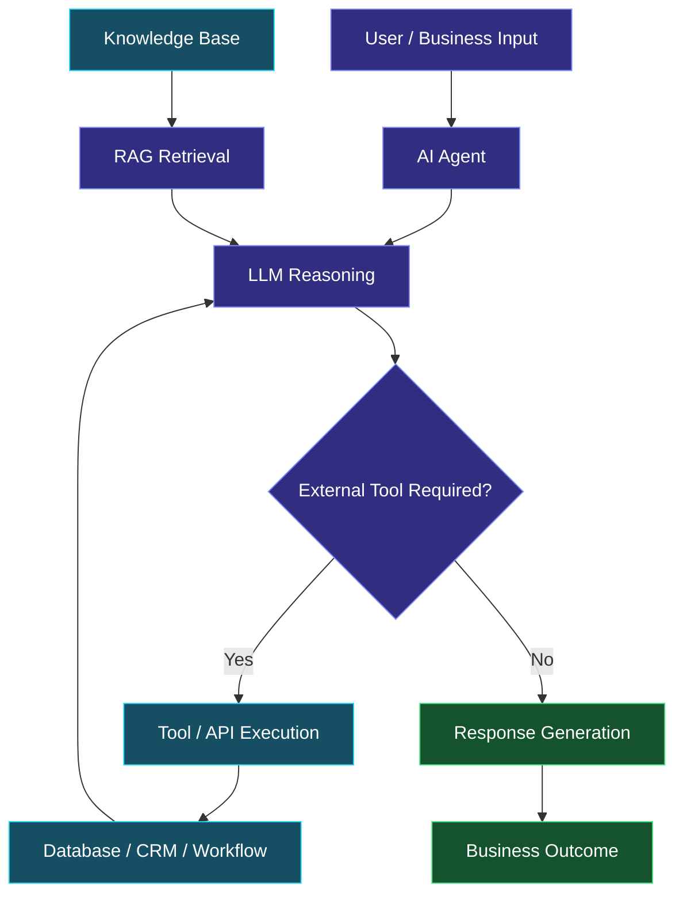

  

  

  
  
  

---

## 👨‍💻 About Me

I'm **Moiz Qadeer**, an AI Engineer and Agentic AI Developer currently working as an **AI Automation Engineer at Logic Flows**.

I specialize in designing and developing intelligent automation systems that combine Large Language Models, AI agents, APIs, databases, and workflow automation to solve real-world business problems.

My approach goes beyond traditional chatbots. I focus on building AI systems that understand context, interact with tools, execute tasks, retrieve information, and automate business processes.

### What I Work On

- Agentic AI and intelligent AI agents.
- AI-powered business automation.
- Retrieval-Augmented Generation (RAG).
- Multi-channel customer support systems.
- AI voice and conversational agents.
- API integrations and backend workflows.
- Lead generation and CRM automation.

---

## ⚡ AI Engineering Specializations

  

<table>
<tr>
<td width="50%" valign="top">

### 🤖 Agentic AI

- AI agents
- Tool calling
- Agent orchestration
- Multi-step reasoning
- Multi-agent workflows

</td>
<td width="50%" valign="top">

### 🧠 RAG Engineering

- Document processing
- Text chunking
- Vector embeddings
- Semantic search
- Knowledge retrieval

</td>
</tr>
<tr>
<td width="50%" valign="top">

### 🎙️ Voice AI

- AI calling agents
- Conversational systems
- Speech-to-text
- Text-to-speech
- Appointment automation

</td>
<td width="50%" valign="top">

### ⚙️ AI Automation

- n8n workflows
- API integrations
- Business automation
- Lead generation
- CRM integrations

</td>
</tr>
</table>

---

## 🛠️ Technical Skills

### Programming Languages

  
  
  
  
  
  

### AI & LLM Technologies

  
  
  
  
  

### Automation & Voice AI

  
  
  
  
  
  

### Databases & Backend

  
  
  
  
  

---

## 🏗️ AI System Architecture

---

## 🚀 Featured Engineering Projects

### 01. AI-Powered Customer Support System

An intelligent customer support solution for e-commerce businesses.

**Key capabilities:**
- Automated WhatsApp customer conversations.
- Product discovery and recommendations.
- Order collection and confirmation.
- Delivery and return policy assistance.
- Customer information management.
- RAG-powered knowledge retrieval.

**Technologies:** n8n, OpenAI, Supabase, RAG, APIs, Google Sheets.

### 02. AI Voice Calling Agents

Conversational AI voice agents for customer interactions and appointment management.

**Key capabilities:**
- Natural voice conversations.
- Customer information collection.
- Appointment scheduling.
- CRM updates.
- Automated notifications.

**Technologies:** Vapi, Retell AI, ElevenLabs, n8n, APIs.

### 03. RAG-Based Knowledge Assistant

An intelligent retrieval system that connects LLMs with custom business knowledge bases.

**Key capabilities:**
- Document ingestion and processing.
- Text chunking and embedding generation.
- Vector similarity search.
- Context-aware AI responses.
- Knowledge base integration.

**Technologies:** Python, OpenAI, Pinecone, Supabase, PostgreSQL.

### 04. Automated Lead Generation System

An automated prospect discovery and lead management pipeline.

**Key capabilities:**
- Business discovery.
- Website data extraction.
- Lead filtering and qualification.
- Duplicate detection.
- Google Sheets integration.

**Technologies:** n8n, Tavily API, JavaScript, Google Sheets.

---

## 💼 Professional Experience

### AI Automation Engineer — Logic Flows

Currently working on developing AI-powered automation solutions that help businesses streamline operations and improve efficiency.

**Areas of work:**

- AI Customer Support Systems.
- AI Voice Calling Agents.
- Intelligent Lead Generation.
- RAG-Based Knowledge Systems.
- Business Process Automation.
- API and CRM Integrations.
- Custom AI Agent Development.
---

## 🤝 Connect With Me

I'm always interested in connecting with AI engineers, developers, founders, and professionals working on meaningful technology.

  
  
  

---

  <b>Engineering Intelligence. Automating Possibilities.</b>

  

